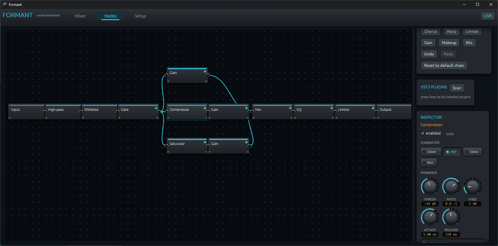
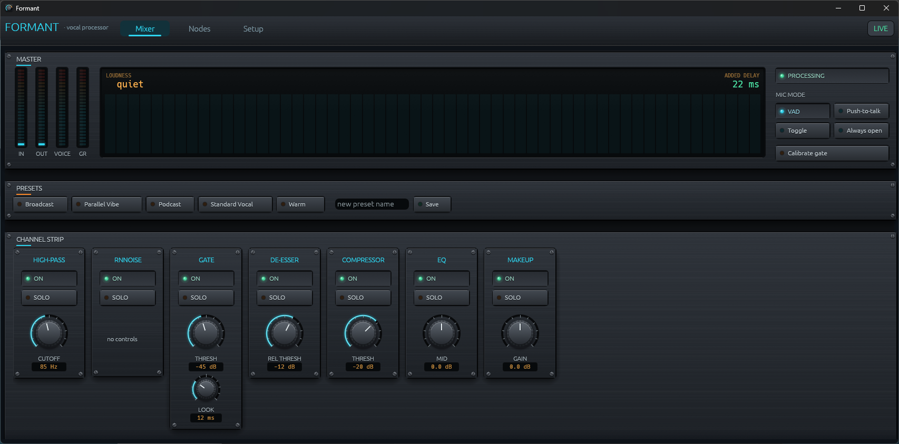

# Formant

Formant processes your voice in real time on Windows. It uses the CPU only. It
sends nothing to the network and it runs no background service. Formant cleans
your microphone signal, shapes your voice, and sends the result to Discord, OBS,
or a game as a second microphone.

[](https://github.com/ABowlOfEleven/Formant/actions/workflows/ci.yml)
[](LICENSE)




*The node editor with the Parallel Vibe preset. The clean voice splits into a dry
path, a compressed path, and a saturated path. A Mix node combines the three
paths again.*

## Why it exists

Most people use Voicemod for two functions. They want a clean voice chain and
noise reduction. Voicemod charges VRAM for those two functions. It also keeps a
connection to a remote API, and it asks you to buy paid features.

Formant keeps only the part that matters. It runs a small RNNoise model and a set
of tuned effects on the CPU. No part of Formant connects to the network. A
virtual audio cable carries the output to any other application.

Formant started as a replacement for this daily workflow. It then got a node
editor. The simple case stays simple. The complex case is available when you want
it.

## How it works

```
your microphone  ->  the Formant chain  ->  your headphones  (you hear yourself)
                                       \->  a virtual audio cable  ->  Discord / OBS / game
```

Formant takes one mono input and processes it one time. It sends the result to
two places at the same time. The first place is your headphones. The second place
is a virtual microphone that other applications read. Set the microphone of an
application to that cable and the setup is complete.

## Features



**The chain.** The chain contains a high-pass filter, RNNoise denoise, a gate, a
de-esser, a compressor, a parametric 3-band EQ, a saturator, a limiter, and gain.
This is enough to make a finished voice from a raw microphone signal. Every node
has a bypass switch, and a global bypass gives you a quick comparison. The Mixer
tab shows the chain as a channel strip with live meters.

The processing aims for the quality of commercial plugins, not only for correct
math. The compressor follows loudness instead of the waveform. It uses a soft
knee and a program-dependent release. The limiter looks ahead, so it reduces the
gain before a peak instead of clipping the peak flat. The limiter also catches
peaks between samples. The saturator runs oversampled, so its harmonics cannot
alias into content unrelated to your voice.

The de-esser attenuates a band around your sibilance. It does not attenuate
everything above a crossover frequency. A harsh "sss" comes under control and
your voice keeps its air.

**The node editor.** Pan, zoom, and connect the nodes as you want. A Mix node
sums its inputs, and any output can feed more than one node. You can build
parallel compression, blended saturation, and a dry/wet balance. The chain is not
limited to a single line of effects.

**VST3 plugin hosting.** Formant finds the VST3 plugins on your machine. Add them
as nodes and open their own editor windows. Formant saves their settings inside
your presets.

**Microphone control.** Voice-activity gating is the default. Push-to-talk,
toggle, and always-open are also available. All four modes use global hotkeys that
you can change or clear.

**Tray operation.** Close the window and the audio continues. Formant permits one
instance only. An optional setting starts Formant with Windows. Formant reopens
with the chain that you left.

**No dropouts.** A drift-compensated resampler on the output path holds the
capture clock and the playback clock in step. Long sessions do not drift into
crackle.

## Requirements

- Windows 10 or 11.
- A virtual audio cable, so other applications can read Formant as a microphone.
  VB-CABLE (free) and Voicemeeter both work.
- Headphones or speakers, if you want to monitor your own voice.

## Install

Download the MSI from the
[Releases](https://github.com/ABowlOfEleven/Formant/releases) page for a standard
install. Download the portable zip if you do not want to run an installer.

To build from source, use these scripts. They install per user and need no
administrator rights.

```powershell
pwsh packaging/install.ps1            # build release, install, add a Start Menu shortcut
pwsh packaging/install.ps1 -Desktop   # also add a Desktop shortcut
pwsh packaging/uninstall.ps1          # remove Formant (add -Purge to delete config and presets)
pwsh packaging/build-portable.ps1     # build a portable zip in dist/
pwsh packaging/build-msi.ps1          # build the MSI in dist/
```

The script installer puts Formant in `%LOCALAPPDATA%\Programs\Formant`. The MSI
installs Formant in `Program Files`. Both keep config and presets in
`%APPDATA%\Formant`.

## First run

1. Open the **Setup** tab.
2. Set the capture device to your microphone.
3. Set the monitor output to your headphones.
4. Set the second output to your virtual audio cable.
5. In Discord, OBS, or your game, set the microphone to that same cable.
6. Shape your sound in the **Mixer** tab and the **Nodes** tab, or load a preset.

Formant includes five presets:

- **Standard Vocal** is the basic single chain. It has a high-pass filter,
  denoise, a gate, a de-esser, a compressor, an EQ, and makeup gain.
- **Broadcast** is tighter and more present. It sounds like a news reader.
- **Warm** is fuller and softer. It adds parallel compression for body and gentle
  saturation in place of hard control.
- **Podcast** stays even and clear over long sessions. It has tighter noise
  control and enough makeup gain for streaming loudness targets.
- **Parallel Vibe** splits the clean voice into three paths: a dry path, a
  heavily compressed path, and a saturated path. A Mix node combines the three
  paths again. This preset shows you how parallel routing works.

All five presets are restrained. A preset that sounds impressive at the first
word usually becomes tiring after a minute. You also cannot remove heavy
processing later in the chain.

## Build and test

```sh
cargo test                              # core DSP, engine, and preset tests
cargo run -p formant -- --seconds 5     # headless: stream the microphone through the chain and report stats
cargo run -p formant                    # the full GUI
```

You can test the complete DSP and graph core without a microphone. This keeps the
math honest.

## Project layout

- `crates/core` (`formant-core`): DSP, the graph engine, routing, presets, and
  session state. This crate is pure and its unit tests need no audio device.
- `crates/audio` (`formant-audio`): the Windows WASAPI backend, device
  enumeration, and global hotkeys.
- `crates/vst3` (`formant-vst3`): VST3 discovery and hosting.
- `crates/app` (`formant`): the egui interface, the tray icon, and the code that
  connects them.

For more detail about the design and the architecture, see [SPEC.md](SPEC.md).

## License

Formant is free software under the GNU General Public License, version 3 or
later. For the full text, see [LICENSE](LICENSE).

Copyright (C) 2026 Ethan Belanger.

Formant uses GPLv3 because it hosts VST3 plugins through the Steinberg interface
definitions. Steinberg supplies those definitions under GPLv3 or under a separate
commercial license.

Formant uses open-source work from other people. This includes RNNoise for noise
reduction and egui for the interface. For credits, see
[THIRD-PARTY-NOTICES.md](THIRD-PARTY-NOTICES.md). VST is a trademark of Steinberg
Media Technologies GmbH. Formant is an independent project and has no affiliation
with Steinberg.
